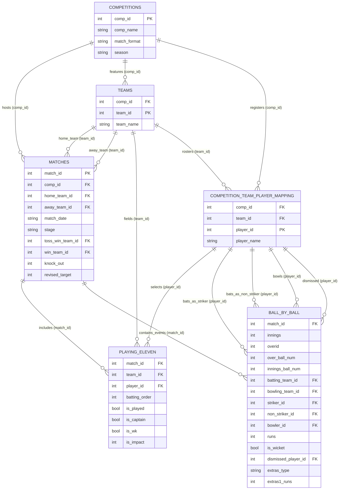

# Dataset Relationship Architecture & Entity-Relationship Mapping

**Project:** SupeRR Selector Season 2  
**Scope:** Formal definition of relational schema, foreign key linkages, entity cardinality, join paths, and integrity rules.

---

## 1. Entity-Relationship Diagram (ERD)



---

## 2. Table-to-Table Relationship Specifications

| Source Table | Target Table | Join Condition | Cardinality | Referential Integrity Rate | Integrity Notes |
| :--- | :--- | :--- | :---: | :---: | :--- |
| `competitions` | `matches` | `competitions.comp_id = matches.comp_id` | `1 : N` | 100% | 138 of 141 competitions have matches. 3 competitions had 0 scheduled/recorded matches. |
| `competitions` | `teams` | `competitions.comp_id = teams.comp_id` | `1 : N` | 100% | Every team entry links to a valid competition. |
| `teams` | `matches` | `teams.team_id = matches.home_team_id` / `away_team_id` | `1 : N` | 100% | All home and away team IDs exist in `teams.csv`. |
| `matches` | `playing_eleven`| `matches.match_id = playing_eleven.match_id` | `1 : N` | 99.7% | 880 of 883 matches have playing XI records. (3 rain-abandoned matches had no toss/XI). |
| `matches` | `ball_by_ball` | `matches.match_id = ball_by_ball.match_id` | `1 : N` | 98.2% | 867 of 883 matches have ball records. (16 rain-abandoned matches had no play). |
| `mapping` | `ball_by_ball` | `mapping.player_id = ball_by_ball.striker_id` | `1 : N` | 100% | **Zero orphan players.** Every striker, non-striker, bowler, and dismissed player resolves to a player mapping record. |
| `teams` | `ball_by_ball` | `teams.team_id = ball_by_ball.batting_team_id` / `bowling_team_id` | `1 : N` | 100% | Perfect team reference alignment. |

---

## 3. Canonical Join Paths

### Path 1: Delivery to Match & Tournament Context
To augment each delivery with tournament format, stage, knockout flag, and venue:
```sql
SELECT 
    b.*,
    m.match_date,
    m.stage,
    m.knock_out,
    m.venue_country,
    m.revised_target,
    c.comp_name,
    c.match_format,
    c.season
FROM ball_by_ball b
INNER JOIN matches m ON b.match_id = m.match_id
INNER JOIN competitions c ON m.comp_id = c.comp_id;
```

### Path 2: Player Resolution
To resolve authoritative player metadata:
```sql
SELECT 
    p.player_id,
    p.player_name,
    p.team_name,
    c.comp_name,
    c.match_format
FROM competition_team_player_mapping p
INNER JOIN competitions c ON p.comp_id = c.comp_id;
```

---

## 4. Join Traps & Architectural Guardrails

1. **NEVER join on `player_name`:**  
   As proved in the forensic audit, 7 player names represent multiple distinct individuals (`Rashid Khan`, `Abdul Samad`, `Haider Ali`, etc.). Always use `player_id`.
2. **NEVER join `teams` on `team_name` alone:**  
   Always use `team_id` and, where tournament-specific context is required, composite `(comp_id, team_id)`.
3. **DO NOT perform naive INNER JOIN between `matches` and `ball_by_ball` without accounting for abandoned matches:**  
   16 matches will drop out if inner joined on delivery data.
4. **DO NOT assume 11 players per team in `playing_eleven`:**  
   IPL matches from 2023 onward utilize the Impact Player substitution rule, expanding active match participants to 12. Always filter by `is_played = true`.
