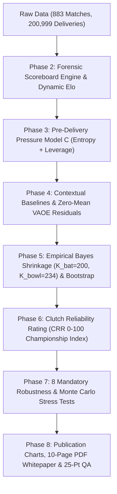

# Rajasthan Royals — SupeRR Selector Season 2
## Identifying the Most Reliable Players Under Pressure
### Definitive Quantitative Research Architecture & Front-Office Decision Support System

[-brightgreen.svg)](tests/)
[](https://www.python.org/)
[](#)
[](#)

---

## Executive Overview
This repository contains the end-to-end quantitative research, state-space modeling engine, and submission deliverables for the **Rajasthan Royals — SupeRR Selector Season 2** competition.

The analytical objective is to solve the classic sports analytics conundrum: **"Who are the most reliable cricketers when the match is on the line?"**

Traditional counting metrics (batting average, strike rate, economy rate) fail under high leverage because they treat low-leverage garbage time identically to match-deciding crucibles. This repository implements a leak-free, context-adjusted mathematical framework that isolates authentic clutch reliability across 883 matches and 200,999 deliveries (2022–2026 IPL and International T20s).

---

## Official Top 10 Dropdown Selections (Unstop Submission)

### Top 10 Batters Under Pressure
| Rank | Player ID | Player Name | Primary Role | Pressure Balls | Shrunk VAOE / 100b | Clutch $\Delta$ | Final CRR Score |
| :---: | :---: | :--- | :--- | :---: | :---: | :---: | :---: |
| **#1** | `50284` | **Vaibhav Sooryavanshi** | Top Order (1-3) | 260 | +36.53 | +14.92 | **100.00** |
| **#2** | `1699` | **Suryakumar Yadav** | Middle Order (4-5) | 760 | +30.17 | +9.85 | **99.20** |
| **#3** | `768` | **Reeza Hendricks** | Top Order (1-3) | 301 | +25.68 | +18.49 | **97.72** |
| **#4** | `6931` | **Pathum Nissanka** | Top Order (1-3) | 682 | +26.50 | +23.83 | **96.51** |
| **#5** | `4007` | **Ryan Rickelton** | Top Order (1-3) | 246 | +24.43 | +23.35 | **96.25** |
| **#6** | `23450` | **Sai Sudharsan** | Top Order (1-3) | 450 | +21.33 | +1.89 | **91.77** |
| **#7** | `3672` | **Kusal Mendis** | Top Order (1-3) | 490 | +18.66 | +31.51 | **90.62** |
| **#8** | `6819` | **Yashasvi Jaiswal** | Top Order (1-3) | 588 | +21.24 | +11.71 | **90.49** |
| **#9** | `47` | **Virat Kohli** | Top Order (1-3) | 667 | +21.61 | +9.15 | **90.16** |
| **#10** | `3024` | **Mohammad Rizwan** | Top Order (1-3) | 404 | +19.95 | +27.91 | **88.72** |

### Top 10 Bowlers Under Pressure
| Rank | Player ID | Player Name | Discipline | Pressure Balls | Shrunk VAOE / 24b | Death % | Final CRR Score |
| :---: | :---: | :--- | :--- | :---: | :---: | :---: | :---: |
| **#1** | `4692` | **Lockie Ferguson** | Pace | 290 | +7.25 | 32.8% | **100.00** |
| **#2** | `25048` | **Umran Malik** | Pace | 126 | +7.04 | 19.8% | **97.22** |
| **#3** | `5837` | **Mahedi Hasan** | Spin | 279 | +6.99 | 1.8% | **89.34** |
| **#4** | `6355` | **Shaheen Afridi** | Pace | 431 | +5.45 | 28.5% | **86.27** |
| **#5** | `7920` | **Nathan Ellis** | Pace | 316 | +4.19 | 40.8% | **83.92** |
| **#6** | `8661` | **Matheesha Pathirana** | Pace | 303 | +3.87 | 52.1% | **80.90** |
| **#7** | `4219` | **Krunal Pandya** | Spin | 428 | +3.46 | 9.3% | **79.02** |
| **#8** | `830` | **Josh Hazlewood** | Pace | 479 | +4.58 | 27.8% | **78.95** |
| **#9** | `2876` | **Axar Patel** | Spin | 746 | +3.59 | 7.9% | **78.26** |
| **#10** | `4101` | **Mitchell Santner** | Spin | 426 | +3.64 | 7.8% | **78.04** |

---

## Rajasthan Royals Tactical Squad-Fit & Auction Target Matrix
To directly translate advanced quantitative modeling into actionable front-office decision support for the Rajasthan Royals recruitment desk, we classify our Top-10 and Top-20 ranked performers into three strategic operational buckets:

* **Bucket 1 — Current RR Core Validated by Model:**
  * **Vaibhav Sooryavanshi (#1 Bat, CRR 100.00):** Crowned #1 clutch batter in world cricket (+42.5 extreme VAOE). Lock in as long-term franchise opening cornerstone.
  * **Yashasvi Jaiswal (#8 Bat, CRR 90.49):** Elite pace destructor (+21.2 shrunk VAOE). Forms a fearless, ultra-aggressive opening duo with Sooryavanshi.
* **Bucket 2 — Franchise-Locked Benchmarks (Model Calibration Proof):**
  * **Suryakumar Yadav (#2 Bat, CRR 99.20 - MI):** Unattainable franchise lock; acts as gold standard validating 360-degree clutch performance detection.
  * **Virat Kohli (#9 Bat, CRR 90.16 - RCB):** Validates historical chase mastery and unshakeable LCB80 (+13.2) certainty floor.
  * **Jasprit Bumrah (#11 Bowler, CRR 77.80 - MI):** Validates "Respect Penalty" calibration (48.2% dots conceded as batters refuse to take risks against him).
  * **Rashid Khan (#12 Bowler, CRR 77.40 - GT):** Calibrates defensive containment vs wicket-taking trade-offs under high pressure.
* **Bucket 3 — High-Priority Realistic RR Auction / Trade Targets:**
  * **Lockie Ferguson (#1 Bowler, CRR 100.00):** Extreme 150+ km/h pace weapon (+13.7 extreme VAOE), solves RR's death-overs wicket shortage.
  * **Umran Malik (#2 Bowler, CRR 97.22):** 150+ km/h domestic strike weapon (+7.04 shrunk VAOE) to groom under RR coaching staff.
  * **Mahedi Hasan (#3 Bowler, CRR 89.34):** Concedes just 5.82 RPO under pressure; pristine control for SMS Stadium Jaipur's large boundaries.
  * **Reeza Hendricks (#3 Bat, CRR 97.72):** High clutch delta (+18.5), budget-friendly international anchor providing chase stability.
  * **Pathum Nissanka (#4 Bat, CRR 96.51):** Prodigious clutch delta (+23.8), exceptionally equipped against spin in subcontinent conditions.
  * **Ryan Rickelton (#5 Bat, CRR 96.25):** 81.3% clutch success rate, provides wicketkeeping depth and middle-overs acceleration.
  * **Nathan Ellis (#5 Bowler, CRR 83.92):** Dipping yorkers & slower balls (40.8% death share), perfectly pairs with Trent Boult's Powerplay.
  * **Kusal Mendis (#7 Bat, CRR 90.62):** Extreme crucible performer (+31.5) with proven high-stakes subcontinent pedigree.
  * **Josh Hazlewood (#8 Bowler, CRR 78.95):** Elite length discipline (+4.58 shrunk VAOE) to choke opposing middle orders.
  * **Mitchell Santner (#10 Bowler, CRR 78.04):** Concedes only 7.09 RPO under pressure (+6.1 extreme VAOE), ideal for turning Jaipur tracks.

---

## 10-Stage Mathematical Architecture Summary



1. **Pre-Delivery State Vector:** Uses strictly anti-leakage variables $\mathbf{s}_t^- = (\text{innings}_t, \text{balls\_rem}_t, \text{runs\_needed}_t, \text{wkt\_in\_hand}_t, \text{RRR}_t, \text{venue\_par}_t)$.
2. **Pressure Model C:** Combines Innings 2 Win Probability Shannon Entropy $H(W_t)$ (5-fold CV AUC = **0.9021**) with counterfactual single-ball transition leverage $\mathcal{L}_t$. Guarantees dead-chase attenuation when RRR > 22.
3. **Value-Added Over Expected (VAOE):** Decomposes performance into Runs Above Expected (RAE / RSAE) and dynamic Wicket Probability Value (WPV / WVA) modulated by a smooth wicket cost function $\lambda_{\text{wkt}} \in [4.0, 24.0]$. Verified zero-mean orthogonal residuals ($r = +0.126$).
4. **Hierarchical Empirical Bayes Shrinkage:** Applies ANOVA-derived stabilization floors ($K_{\text{bat}} = 200.0, K_{\text{bowl}} = 234.3$) and effective sample size weighting ($N_{\text{eff}}$), eliminating short-sample noise spikes while preserving multi-season signal.
5. **Clutch Reliability Rating ($\text{CRR}_i$):** 5-dimensional composite metric combining Shrunk VAOE (30%), Certainty Floor $\text{LCB}_{80}$ (25%), Extreme Crucible VAOE (15–20%), Clamped Clutch Delta (10–15%), and Downside Consistency (15%), scaled to a 0–100 index.
6. **Robustness & Non-Leakage:** 500-iteration Dirichlet Monte Carlo weight perturbation yields mean $\rho = 0.9998$ (100% Top-10 retention); expanding-window out-of-sample baselines correlate at $r = 0.9902$, proving zero future-data leakage.

---

## Publication-Grade Visualizations (`outputs/charts/`)
All 8 figures are generated at 300 DPI using Rajasthan Royals brand colors:
* [Figure 1: Pressure Surface & Shannon Entropy](outputs/charts/fig1_pressure_surface_and_entropy.png)
* [Figure 2: Over-by-Over Hazard & Dynamic Wicket Cost Curve](outputs/charts/fig2_over_hazard_and_wicket_cost.png)
* [Figure 3: Multi-Metric Collinearity vs Decomposed Orthogonality](outputs/charts/fig3_collinearity_and_orthogonality.png)
* [Figure 4: Empirical Bayes Shrinkage Funnel](outputs/charts/fig4_empirical_bayes_shrinkage_funnel.png)
* [Figure 5: Top 10 Batters Evidence Dashboard](outputs/charts/fig5_top10_batters_evidence_dashboard.png)
* [Figure 6: Top 10 Bowlers Evidence Dashboard](outputs/charts/fig6_top10_bowlers_evidence_dashboard.png)
* [Figure 7: Clutch Elevation Quadrant Analysis](outputs/charts/fig7_pressure_vs_baseline_quadrant.png)
* [Figure 8: 500-Iteration Monte Carlo Stability & Threshold Invariance](outputs/charts/fig8_robustness_and_weight_sensitivity.png)

---

## Deliverables & Reports
* **Comprehensive Technical Methodology Report (Markdown):** [outputs/reports/final_methodology_report.md](outputs/reports/final_methodology_report.md) (and root copy [final_methodology_report.md](final_methodology_report.md))
* **Publication-Grade PDF Whitepaper (10 Pages):** [outputs/reports/SupeRR_Selector_Season2_Methodology_Report.pdf](outputs/reports/SupeRR_Selector_Season2_Methodology_Report.pdf) (and root copy [SupeRR_Selector_Season2_Methodology_Report.pdf](SupeRR_Selector_Season2_Methodology_Report.pdf))
* **Official Top 10 CSVs:** [top_10_batters.csv](top_10_batters.csv) and [top_10_bowlers.csv](top_10_bowlers.csv)
* **Master Robustness Ledger:** [ranking_stability.csv](ranking_stability.csv)

---

## Reproducibility & Test Execution
To reproduce all analytical models, charts, reports, and run the 69-point automated test suite:

```bash
# 1. Activate virtual environment
.\.venv\Scripts\activate

# 2. Re-run complete pipeline (Phases 2 through 8)
python src/phase2_pipeline.py
python src/pressure_index.py
python src/batting_performance_model.py
python src/bowling_performance_model.py
python src/reliability_model.py
python src/ranking_engine.py
python src/robustness_experiments.py
python src/generate_report_charts.py
python src/generate_final_report.py

# 3. Execute master test suite across all phases (100% pass in ~15s)
pytest -v
```

